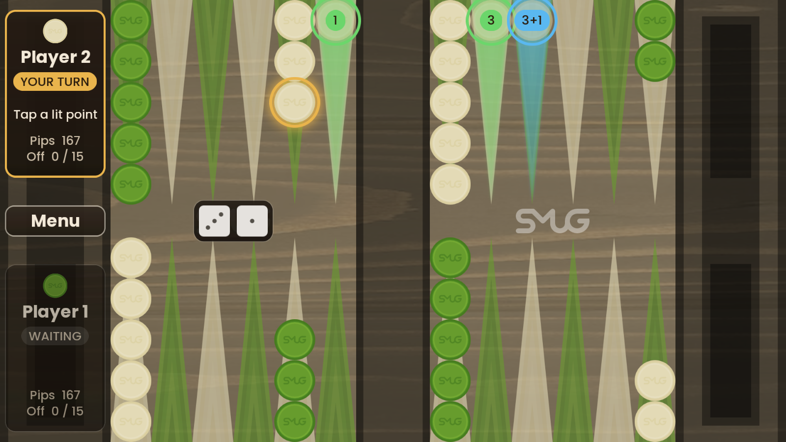

# Backgammon

[Backgammon](https://en.wikipedia.org/wiki/Backgammon) for two players on one device, built with [libGDX](https://libgdx.com/).
Each player has fifteen checkers and moves them around twenty-four points according to the roll of two dice;
the first player to bear off all fifteen wins.



## How to play

| Action | Mouse / touch | Keyboard |
|---|---|---|
| Roll the dice | **Roll dice** button (shown on the side of the player to move) | `Space` / `Enter` |
| Select a checker | Tap any checker on a point; gold rings mark the checkers that can move | |
| Move | Tap a lit point (or the lit bear-off tray) | |
| Cancel the selection | Tap elsewhere / right click | `Esc` |
| Leave the game | **Menu** button | `Esc` (Android: back) |

Highlights after selecting a checker:

- **Green**: reachable with one die (the badge shows which, e.g. `5`).
- **Blue**: reachable by moving the same checker with several dice (e.g. `3+5`); every step on the way is legal.
- **Red**: the move hits a single opposing checker and sends it to the bar.
- A translucent "ghost" checker shows exactly where the checker will land.

Checkers on the bar are selected automatically (they must enter first), and so is the only checker that can move.
Used dice stay visible but greyed out; doubles show four dice. The player cards on the left show whose turn it is,
what to do next, the pip count and how many checkers are borne off.

### Rules implemented

- Starting position: 2 checkers on the 24-point, 5 on the 13, 3 on the 8 and 5 on the 6 (per player).
- Bright moves from the bottom right along the bottom row and back along the top; its home board is top right.
  Dark moves the opposite way; its home board is bottom right.
- A checker may land on an empty point, its own point, or a single opposing checker (a hit). Points held by two or
  more opposing checkers are blocked.
- Hit checkers go to the bar and must re-enter in the opponent's home board before any other checker moves.
- Doubles are played four times.
- A player must use as many dice as possible; if only one die can be used, it must be the larger one when possible.
- Bearing off starts once all checkers are in the home board. A higher die may bear off the farthest checker.
- If no move is possible, the turn passes automatically.
- Results: a normal win scores 1 point, a **gammon** (loser bore off nothing) 2, a **backgammon** (gammon with a
  loser's checker still on the bar or in the winner's home board) 3. The leaderboard ranks players by wins, then points.

Not implemented (yet): the doubling cube and the opening roll (who starts is chosen in Settings).

## Building and running

Requirements: **JDK 17 or newer — JDK 21 LTS recommended** (e.g. [Eclipse Temurin 21](https://adoptium.net/temurin/releases/?version=21)).
Gradle itself is downloaded by the wrapper.

```bash
./gradlew desktop:run        # play (Windows: gradlew.bat desktop:run)
./gradlew test               # run the unit tests
./gradlew desktop:jar        # runnable JAR: desktop/build/libs/Backgammon-<version>.jar
```

**Android** (optional): the `android` module is only included when an Android SDK is configured, either via
`ANDROID_HOME` / `ANDROID_SDK_ROOT` or a `local.properties` file in the project root containing
`sdk.dir=C:\\Users\\<you>\\AppData\\Local\\Android\\Sdk`. Then: `./gradlew android:installDebug`.

Versions: libGDX 1.14.2, LWJGL 3.4.3, Gradle 9.8.1, Android Gradle Plugin 8.9.3 (compile/target SDK 36, min SDK 21),
Java 17 language level, JUnit 6.

## Project structure

```
core/src/main/java/si/um/feri/backgammon/
  model/        Game rules: Board, Move, Rules (legal moves), Game (turn flow), DiceRoll. No libGDX, fully unit-tested.
  persistence/  Settings (libGDX Preferences) and the Leaderboard (JSON file).
  view/         BoardLayout (board geometry), BoardView (board, checkers, highlights, animation),
                DiceTray, PlayerPanel, Ui helpers.
  screen/       Intro, Menu, Settings, Leaderboard and Game screens.
  audio/        Music and sound effects.
core/src/test/java/...  JUnit tests for the rules, the board geometry and the leaderboard.
desktop/        LWJGL3 launcher; src/tools holds the texture packer.
android/        Android launcher (optional module).
assets/         Runtime assets (texture atlases, fonts, skin, audio).
desktop/assets-raw/  Source images for the texture atlases.
tools/generate_ui_assets.py  Generates the UI skin images and bitmap fonts.
```

### Changing the UI art

1. `python tools/generate_ui_assets.py` regenerates the skin images and bitmap fonts (needs Pillow, fontTools and the
   Poppins fonts; see the script header).
2. `./gradlew desktop:packAssets` repacks `desktop/assets-raw/*` into the atlases in `assets/`.

## Credits

- UI font: [Poppins](https://github.com/itfoundry/Poppins), SIL Open Font License 1.1 (`assets/ui/font/Poppins-OFL.txt`).
- Built with [libGDX](https://libgdx.com/) (Apache 2.0).
