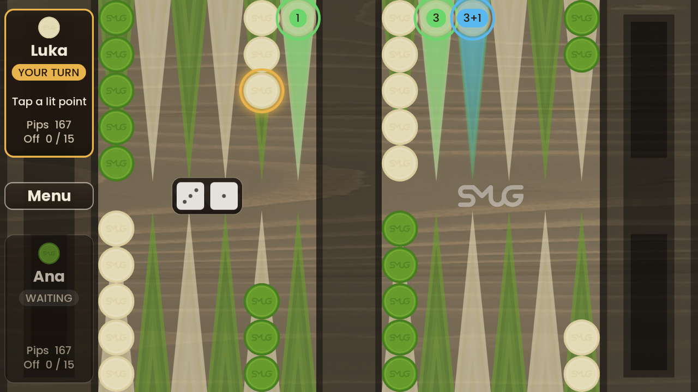
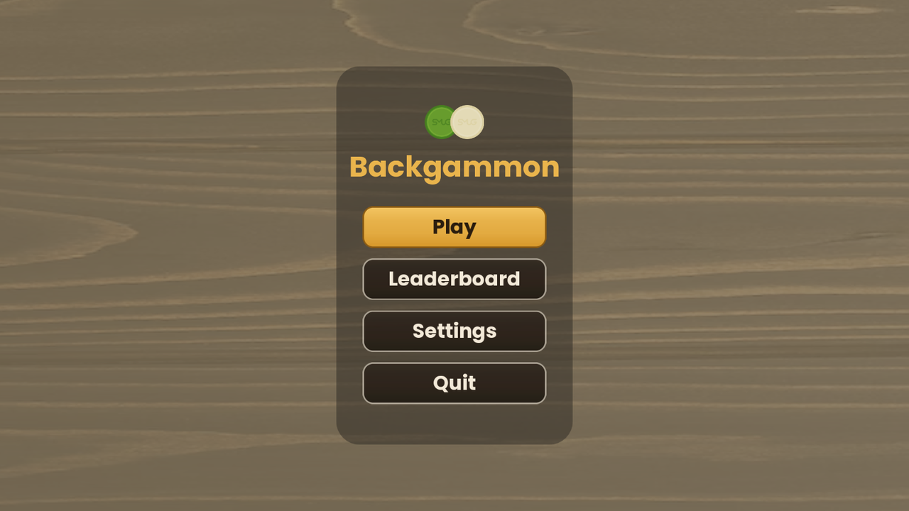
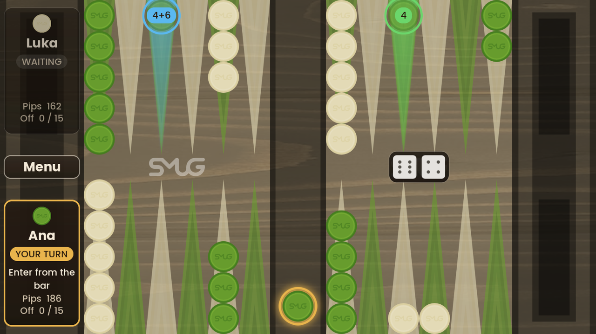
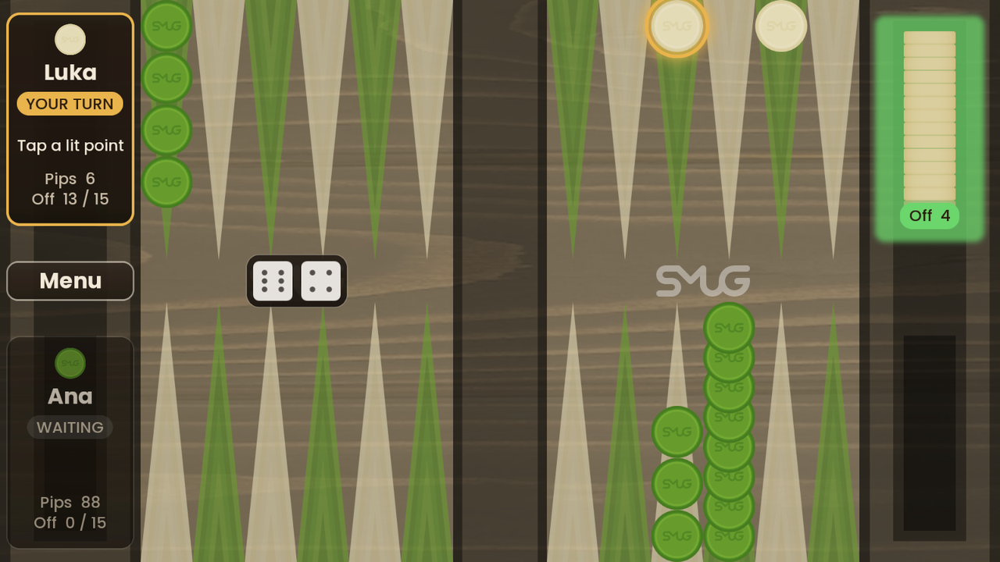
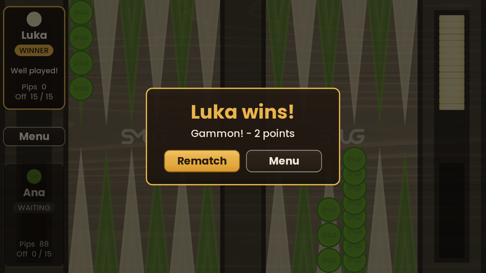
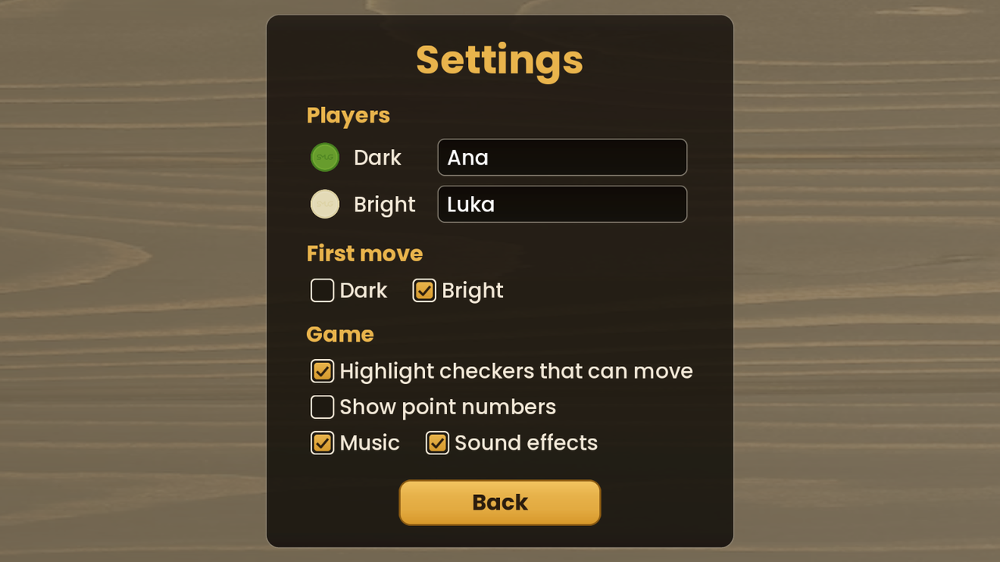
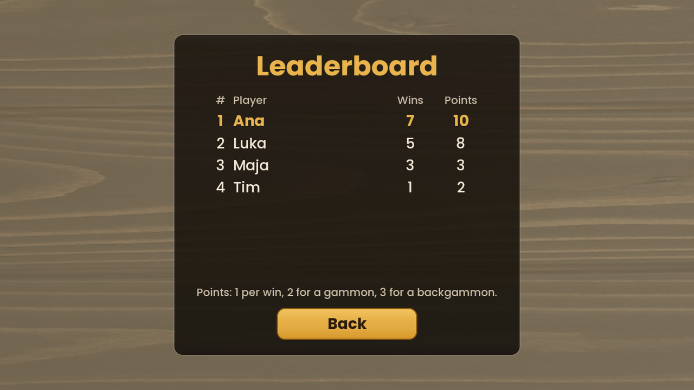

# Backgammon

[Backgammon](https://en.wikipedia.org/wiki/Backgammon) for two players on one device, built with [libGDX](https://libgdx.com/).
Each player has fifteen checkers and moves them around twenty-four points according to the roll of two dice;
the first player to bear off all fifteen wins.



## Quick start

1. Install **JDK 21** ([instructions below](#1-install-java-jdk-21)).
2. Open a terminal in the project folder and run:

   | Windows | macOS / Linux |
   |---|---|
   | `gradlew.bat desktop:run` | `./gradlew desktop:run` |

The first run downloads Gradle and the libraries (a few hundred MB, needs internet) and takes a few minutes.
Later runs start in seconds.

**Just want to play?** Ready-to-run packages for Windows, Linux and macOS that do not need Java installed are attached
to each tagged version on the [Releases page](https://github.com/cgorican/gdx-backgammon/releases), or can be built with
one command (see [Native executables](#native-executables-no-java-needed-to-play)).

## Screenshots

| | |
|---|---|
|  |  |
| **Main menu** | **Entering from the bar**: the checker on the bar is selected automatically; the 4 enters (green), 4+6 goes further (blue) |
|  |  |
| **Bearing off**: the tray lights up and shows which die is used | **Game over**: single game, gammon or backgammon |
|  |  |
| **Settings**: player names, who starts, hints, sound | **Leaderboard**: wins and points per player |

## How to play

| Action | Mouse / touch | Keyboard |
|---|---|---|
| Roll the dice | **Roll dice** button (shown on the side of the player to move) | `Space` / `Enter` |
| Select a checker | Tap any checker on a point; gold rings mark the checkers that can move | |
| Move | Tap a lit point (or the lit bear-off tray) | |
| Cancel the selection | Tap elsewhere / right click | `Esc` |
| Leave the game | **Menu** button | `Esc` (Android: back) |

Highlights after selecting a checker:

- **Green**: reachable with one die (the badge shows which, e.g. `5`).
- **Blue**: reachable by moving the same checker with several dice (e.g. `3+5`); every step on the way is legal.
- **Red**: the move hits a single opposing checker and sends it to the bar.
- A translucent "ghost" checker shows exactly where the checker will land.

Checkers on the bar are selected automatically (they must enter first), and so is the only checker that can move.
Used dice stay visible but greyed out; doubles show four dice. The player cards on the left show whose turn it is,
what to do next, the pip count and how many checkers are borne off.

### Rules implemented

- Starting position: 2 checkers on the 24-point, 5 on the 13, 3 on the 8 and 5 on the 6 (per player).
- Bright moves from the bottom right along the bottom row and back along the top; its home board is top right.
  Dark moves the opposite way; its home board is bottom right.
- A checker may land on an empty point, its own point, or a single opposing checker (a hit). Points held by two or
  more opposing checkers are blocked.
- Hit checkers go to the bar and must re-enter in the opponent's home board before any other checker moves.
- Doubles are played four times.
- A player must use as many dice as possible; if only one die can be used, it must be the larger one when possible.
- Bearing off starts once all checkers are in the home board. A higher die may bear off the farthest checker.
- If no move is possible, the turn passes automatically.
- Results: a normal win scores 1 point, a **gammon** (loser bore off nothing) 2, a **backgammon** (gammon with a
  loser's checker still on the bar or in the winner's home board) 3. The leaderboard ranks players by wins, then points.

Not implemented (yet): the doubling cube and the opening roll (who starts is chosen in Settings).

## Setup

### 1. Install Java (JDK 21)

The build needs a **JDK 17 or newer; JDK 21 LTS is recommended**. Any distribution works; the commands below install
[Eclipse Temurin](https://adoptium.net/installation/) or the OpenJDK package of your Linux distribution.
Gradle itself does not need to be installed: the `gradlew` wrapper downloads it.

**Windows** (PowerShell or Command Prompt):

```powershell
winget install EclipseAdoptium.Temurin.21.JDK
```

Alternatively, download the `.msi` installer from [adoptium.net](https://adoptium.net/temurin/releases/?version=21&os=windows)
and enable **Set JAVA_HOME variable** during setup. Open a **new** terminal afterwards.

**macOS** (with [Homebrew](https://brew.sh/)):

```bash
brew install --cask temurin@21
```

Alternatively, download the `.pkg` installer from [adoptium.net](https://adoptium.net/temurin/releases/?version=21&os=mac).

**Linux**:

```bash
# Ubuntu 22.04+ / Debian 13+
sudo apt update && sudo apt install openjdk-21-jdk
# Debian 12 (JDK 17 also works)
sudo apt update && sudo apt install openjdk-17-jdk

# Fedora / RHEL
sudo dnf install java-21-openjdk-devel

# Arch Linux
sudo pacman -S jdk21-openjdk
```

Alternatively, use [SDKMAN!](https://sdkman.io/) (`sdk list java`, then `sdk install java <21.x.x>-tem`).

**Check the installation** (in a new terminal):

```bash
java -version     # should print version 21 (or 17+)
```

If `java` is not found, add the JDK's `bin` folder to `PATH` or set `JAVA_HOME` to the JDK folder.
The build asks Gradle for a JDK 21 daemon (`gradle/gradle-daemon-jvm.properties`); if you only have another version
installed, Gradle downloads a matching JDK 21 automatically on the first build.

### 2. Get the code

```bash
git clone https://github.com/cgorican/gdx-backgammon.git
cd gdx-backgammon
```

## Running and building

All commands are run from the project folder. On **Windows** use `gradlew.bat <task>`; on **macOS / Linux** use
`./gradlew <task>`. (If `./gradlew` reports "permission denied", run `chmod +x gradlew` once.)

| Task | Command (macOS / Linux) | What it does |
|---|---|---|
| Play | `./gradlew desktop:run` | Builds and starts the desktop game |
| Unit tests | `./gradlew test` | Runs the rules, layout and leaderboard tests (report: `core/build/reports/tests/test/index.html`) |
| Runnable JAR | `./gradlew desktop:jar` | Creates `desktop/build/libs/Backgammon-1.1.0.jar` |
| App folder | `./gradlew desktop:installDist` | Creates `desktop/build/install/Backgammon/` with launch scripts in `bin/` |
| App zip | `./gradlew desktop:distZip` | Zips the above: `desktop/build/distributions/Backgammon-1.1.0.zip` |
| Everything | `./gradlew build` | Compiles all modules and runs the tests |
| Clean | `./gradlew clean` | Deletes all build output |
| Native executables | `./gradlew desktop:packageAll` | Windows / Linux / macOS packages with a bundled Java runtime in `dist/` ([details](#native-executables-no-java-needed-to-play)) |
| Repack textures | `./gradlew desktop:packAssets` | Rebuilds the atlases in `assets/` from `desktop/assets-raw/` |

**Running the built JAR** (it contains everything; only Java is needed on the target machine):

```bash
java -jar desktop/build/libs/Backgammon-1.1.0.jar                         # Windows / Linux
java -XstartOnFirstThread -jar desktop/build/libs/Backgammon-1.1.0.jar    # macOS
```

You can also double-click the JAR if `.jar` files are associated with Java (the Temurin installer offers this),
or unzip the app zip and run `bin\Backgammon.bat` (Windows) / `bin/Backgammon` (macOS / Linux).

Settings and the leaderboard are stored per user: `%USERPROFILE%\.prefs\BackgammonGame` on Windows,
`~/.prefs/BackgammonGame` on macOS / Linux, and the app's private storage on Android. A `backgammon_leaderboard.json`
left by older versions in the game folder is imported automatically on first start.

### Native executables (no Java needed to play)

The game can be packaged as a native application that bundles its own trimmed-down Java runtime, so players just
unzip and double-click. This uses the [Construo](https://github.com/fourlastor-alexandria/construo) Gradle plugin, which
can build **every platform from any OS** (e.g. the macOS app from a Windows PC).

| Target | Command (macOS / Linux) | Output in `dist/` | Contents |
|---|---|---|---|
| All of the below | `./gradlew desktop:packageAll` | all four zips | |
| Windows (x64) | `./gradlew desktop:packageWinX64` | `Backgammon-winX64.zip` | `Backgammon.exe`, `runtime/`, game JAR |
| Linux (x64) | `./gradlew desktop:packageLinuxX64` | `Backgammon-linuxX64.zip` | `Backgammon` executable, `runtime/`, game JAR |
| macOS (Apple Silicon) | `./gradlew desktop:packageMacM1` | `Backgammon-macM1.zip` | `Backgammon.app` |
| macOS (Intel) | `./gradlew desktop:packageMacX64` | `Backgammon-macX64.zip` | `Backgammon.app` |

On Windows use `gradlew.bat desktop:packageAll` etc.

- The first build of each target downloads that platform's JDK (about 200 MB, cached in `desktop/build/construo/`)
  and the native launcher. Both downloads are checked against pinned SHA-256 checksums.
- Each package is roughly 40 MB zipped (about 85 MB unpacked); the bundled runtime is Eclipse Temurin 21 trimmed
  with `jlink`.
- Packaging needs JDK 21 for the build itself (the bundled runtime must match the `jlink` version). Gradle takes care
  of this via `gradle/gradle-daemon-jvm.properties`.
- The packages are not code-signed, so the operating system warns on first launch:
  - **Windows** SmartScreen: click *More info*, then *Run anyway*.
  - **macOS** Gatekeeper: right-click the app, choose *Open*, then *Open* again (or run
    `xattr -dr com.apple.quarantine Backgammon.app` once). Distributing to others without the warning needs an Apple
    Developer ID signature and notarization.
  - **Linux**: unzip with a tool that keeps file permissions (e.g. `unzip`), then run `./Backgammon`.
- To update the bundled JDK or launcher, change the URLs / versions together with their checksums in the
  `construo { }` block of `desktop/build.gradle`.
- App icons are generated by `tools/generate_icons.py` into `desktop/icons/` (Windows `.exe`, macOS `.icns`) and
  `desktop/src/main/resources/icons/` (window icon).

### Continuous integration

`.github/workflows/build.yml` runs on GitHub Actions for every push and pull request: it builds the project, runs the
tests, and packages all four targets (download them from the run's *Artifacts* section). Pushing a version tag
publishes the packages as a GitHub Release:

```bash
git tag v1.1.0
git push origin v1.1.0
```

### Android (optional)

The `android` module is only included when an Android SDK is configured, so the desktop game never needs it.
Install [Android Studio](https://developer.android.com/studio) (or the command-line SDK tools) and either set the
`ANDROID_HOME` environment variable or create `local.properties` in the project root:

```properties
# Windows (note the escaped backslashes)
sdk.dir=C\:\\Users\\<you>\\AppData\\Local\\Android\\Sdk
# macOS
sdk.dir=/Users/<you>/Library/Android/sdk
# Linux
sdk.dir=/home/<you>/Android/Sdk
```

| Task | Command (macOS / Linux) |
|---|---|
| Install on a connected device / emulator | `./gradlew android:installDebug` |
| Start the installed app | `./gradlew android:run` |
| Debug APK | `./gradlew android:assembleDebug` (output in `android/build/outputs/apk/debug/`) |

### IDE

Open the project folder in **IntelliJ IDEA** or **Android Studio** as a Gradle project and run the `desktop:run`
Gradle task, or run `si.um.feri.backgammon.DesktopLauncher` directly with `assets/` as the working directory.

### Versions

libGDX 1.14.2, LWJGL 3.4.3, Gradle 9.8.1 (wrapper), Android Gradle Plugin 8.9.3 (compile/target SDK 36, min SDK 21),
Java 17 language level, JUnit 6.

## Project structure

```
core/src/main/java/si/um/feri/backgammon/
  model/        Game rules: Board, Move, Rules (legal moves), Game (turn flow), DiceRoll. No libGDX, fully unit-tested.
  persistence/  Settings (libGDX Preferences) and the Leaderboard (JSON file).
  view/         BoardLayout (board geometry), BoardView (board, checkers, highlights, animation),
                DiceTray, PlayerPanel, Ui helpers.
  screen/       Intro, Menu, Settings, Leaderboard and Game screens.
  audio/        Music and sound effects.
core/src/test/java/...  JUnit tests for the rules, the board geometry and the leaderboard.
desktop/        LWJGL3 launcher; src/tools holds the texture packer; icons/ holds the packaged-app icons.
android/        Android launcher (optional module).
assets/         Runtime assets (texture atlases, fonts, skin, audio).
desktop/assets-raw/  Source images for the texture atlases.
tools/generate_ui_assets.py  Generates the UI skin images and bitmap fonts.
tools/generate_icons.py      Generates the application icons.
.github/workflows/  GitHub Actions: build, test, package, release.
img/            Screenshots used in this README.
```

### Changing the UI art

1. `python tools/generate_ui_assets.py` regenerates the skin images and bitmap fonts (needs Pillow, fontTools and the
   Poppins fonts; see the script header).
2. `./gradlew desktop:packAssets` repacks `desktop/assets-raw/*` into the atlases in `assets/`.

See [CHANGELOG.md](CHANGELOG.md) for what changed in each version.

## Credits

- UI font: [Poppins](https://github.com/itfoundry/Poppins), SIL Open Font License 1.1 (`assets/ui/font/Poppins-OFL.txt`).
- Built with [libGDX](https://libgdx.com/) (Apache 2.0).
